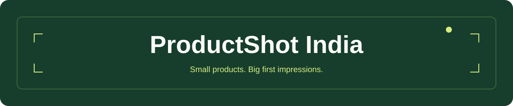
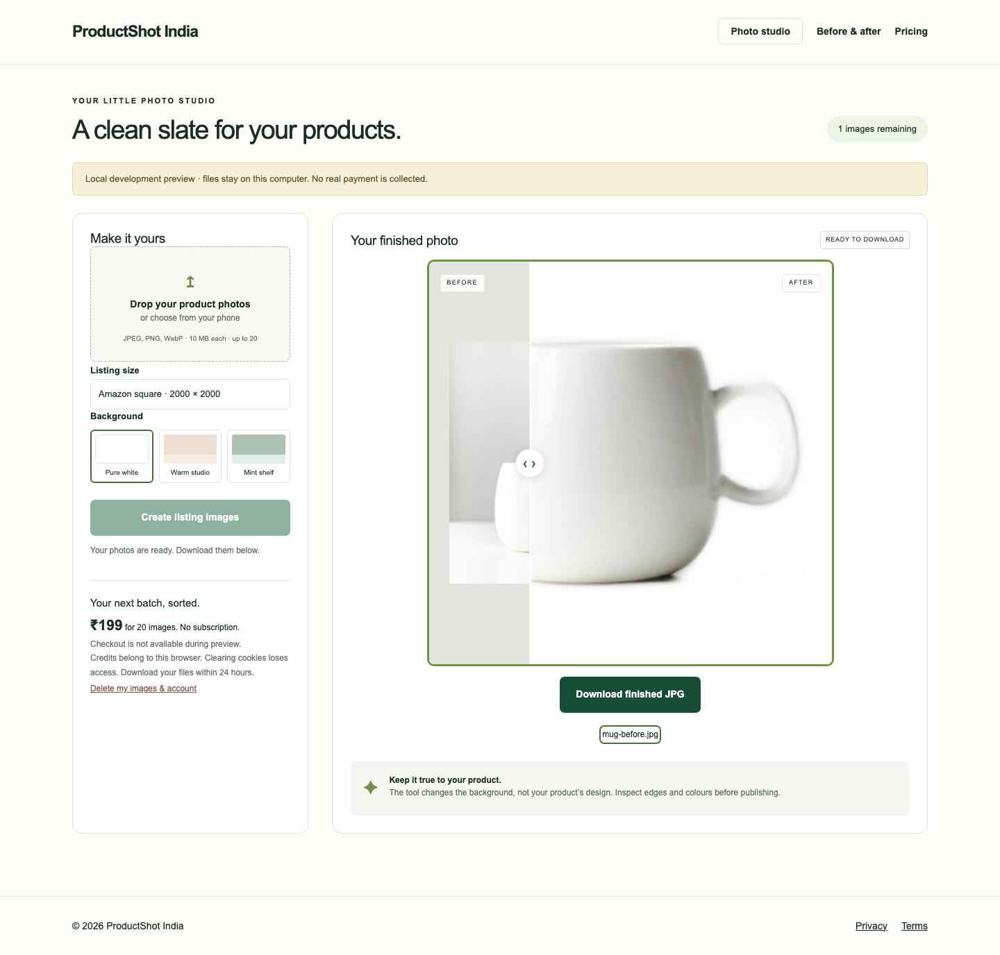
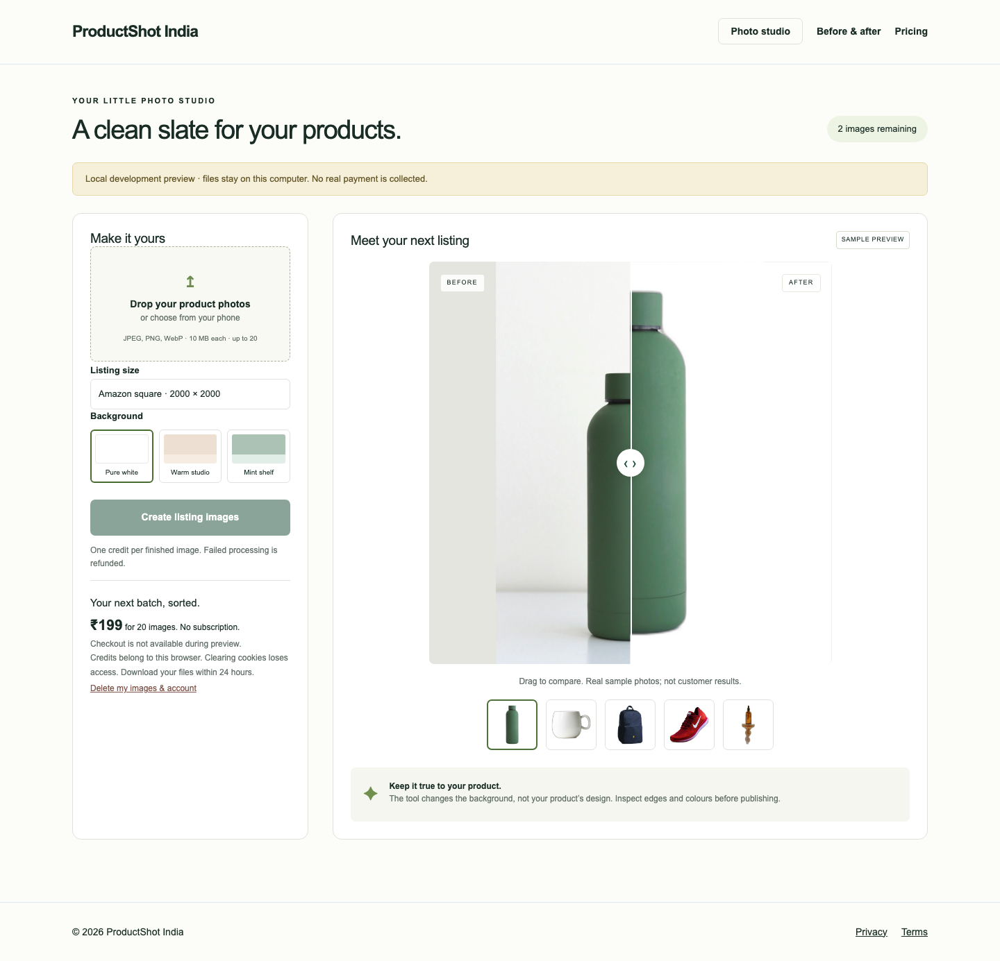
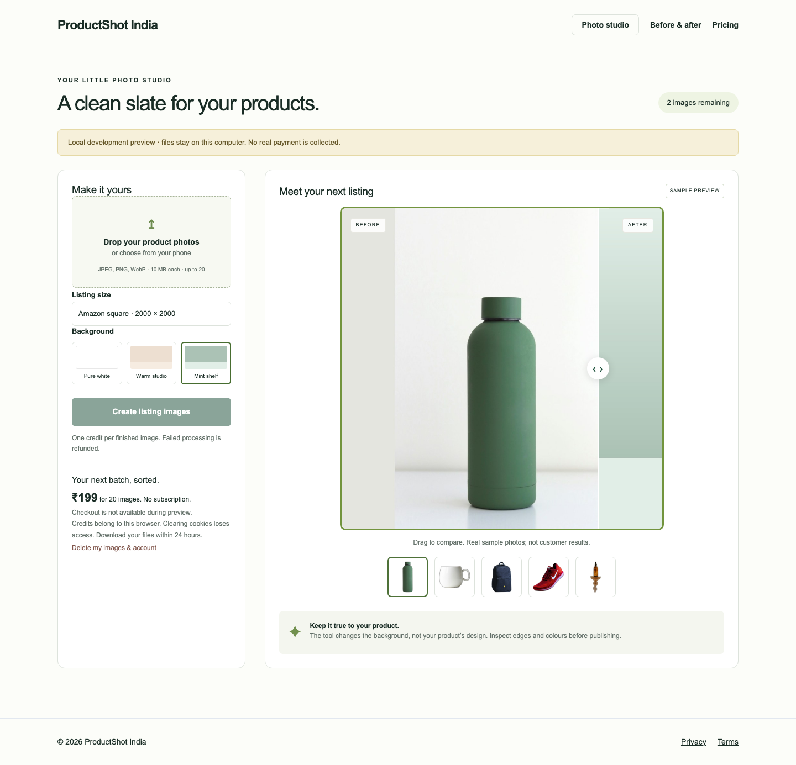
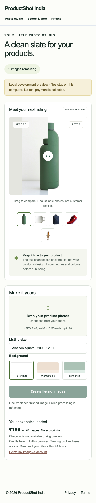
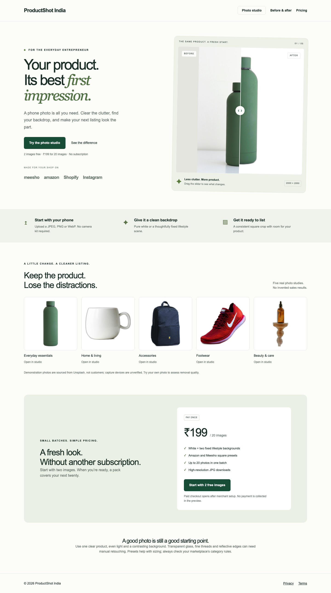
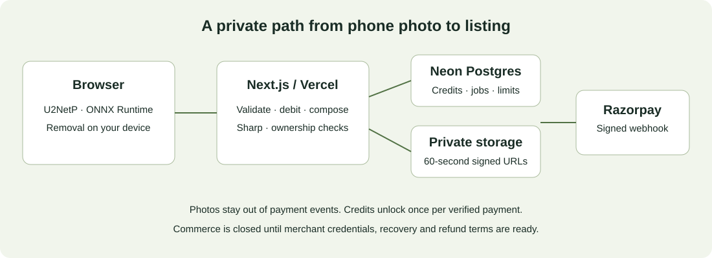
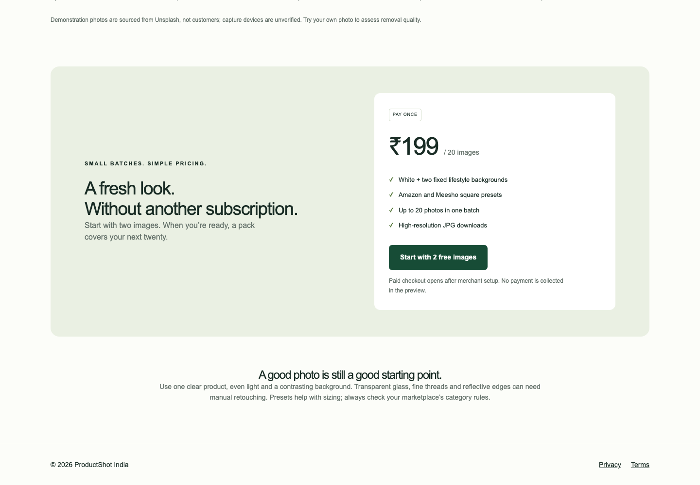

<p align="center"></p>
<p align="center">Clean product photos for the everyday Indian seller.</p>
<p align="center"><a href="https://nextjs.org/"></a> <a href="https://www.typescriptlang.org/"></a> <a href="LICENSE"></a> <a href="package.json"></a> <a href="https://productshot-india.vercel.app"></a></p>

## The problem
A solo seller has a good product, a phone camera and twenty listings to finish. The practical job is simple: “Make the product clear, make the background consistent, and let me get back to selling.” This is a job hypothesis, not a fabricated customer quote. Existing editors often bundle a large creative suite or recurring subscription around that small job.

## How we felt it
The workflow that motivated this build was the repeated handoff: take a photo, remove its background, open another editor, crop to a square, resize, export, repeat. We built around that sequence. No founder anecdote, customer interview or sales lift is claimed without evidence. [Research and the cheapest willingness-to-pay test](PLAN.md) are explicit.

## What we built
### One photo, a cleaner background
Local U2NetP segmentation runs in the browser. A bounded server pipeline validates, strips metadata, crops the foreground and centres it on a square export. First use downloads the model and runtime; fine edges still deserve inspection.


### Listing sizes that stay consistent
Choose a 2000 × 2000 Amazon square or 1080 × 1080 Meesho square. These are export presets, not category approval guarantees. Source images are normalized to a 1400 px long edge; export dimensions do not create missing detail.


### A fixed set of lifestyle scenes
Pure white, warm studio and mint shelf keep the choice small. There is no prompt box, image generation or product alteration.


### Batch credits without recurring billing
The queue accepts up to 20 images. Two image credits are free. A ₹199 pack is designed to add 20 credits once after a signed Razorpay notification; duplicate delivery does not add credits twice. Live checkout is closed pending merchant setup, verified refund/support details. Tests exercise signed settlement; they are not real purchases.


### Before and after, side by side
A keyboard-accessible slider lets you inspect what changed before downloading. Five real sample photographs demonstrate the pipeline; they are not customer results and their capture devices are unverified.


## How it works

1. A browser cookie identifies a random, server-hashed account; no email is collected.
2. U2NetP removes the background locally; only selected image data reaches our own processing endpoint.
3. Sharp validates and composites while Neon atomically reserves an image credit.
4. Private Neon objects are owner-scoped; downloads use 60-second signatures and expire after 24 hours.
5. Verified payments update credits once; daily cleanup deletes expired objects, normally within 48 hours.

## Quickstart
Requires Node 22.13+ and npm. Four commands start the local development preview without cloud credentials:
```sh
git clone https://github.com/SayedZahur786/productshot-india.git
cd productshot-india
npm ci
LOCAL_PREVIEW=1 npm run dev
```
Open [localhost:3000](http://localhost:3000). The repository is private, so clone access requires authorization. Local preview stores files and credits under ignored `.local/`; it never processes real payments. Use `npm run build` followed by `LOCAL_PREVIEW=1 npm start` for the production build.

## Screenshots
Real Playwright captures cover every main route at desktop and 390 px mobile widths. [Screenshot test](tests/shots.spec.ts) runs against a production build and saves files into [docs/screenshots](docs/screenshots).

| Desktop | Mobile |
| --- | --- |
| [Home](docs/screenshots/home-desktop.png) | [Home](docs/screenshots/home-mobile.png) |
| [Studio](docs/screenshots/studio-desktop.png) | [Studio](docs/screenshots/studio-mobile.png) |
| [Privacy](docs/screenshots/privacy-desktop.png) | [Privacy](docs/screenshots/privacy-mobile.png) |
| [Terms](docs/screenshots/terms-desktop.png) | [Terms](docs/screenshots/terms-mobile.png) |
| [404](docs/screenshots/404-desktop.png) | [404](docs/screenshots/404-mobile.png) |

## Demo video
[](docs/demo.mp4)

[Watch the 57-second MP4](docs/demo.mp4). Real browser recording, spoken narration and large burned-in captions. [Storyline](docs/demo-story.md), [recording script](scripts/record-demo.mjs), [render script](scripts/render-demo.py), [transcript](docs/narration.txt). The demo shows the local preview; no live payment is depicted.

## Why this is interesting
- **Same-origin model, no per-photo inference bill.** A small U2NetP model avoids an external image API. The trade-off is browser CPU use, a first-use download and imperfect masks on glass or fine detail.
- **Credits are a server invariant.** Atomic reservation and idempotent webhook settlement protect the balance. Processing errors refund reservations; a durable job ledger lets daily cleanup restore credits left by interrupted requests.
- **Private storage with a short useful life.** Originals and results use random owner-scoped keys, short-lived signatures and daily cleanup. Anonymous cookies keep onboarding small but lack recovery, so paid launch stays gated.

## Configuration and data
[neon.ts](neon.ts) declares the private bucket; [migrations](migrations/001_initial.sql) owns the relational schema. `neon deploy` writes ignored environment values; `npm run migrate` applies the schema. Required production values: `DATABASE_URL`, `AWS_ACCESS_KEY_ID`, `AWS_SECRET_ACCESS_KEY`, `AWS_ENDPOINT_URL_S3`, `AWS_REGION`, `CRON_SECRET`, and `NEXT_PUBLIC_SITE_URL`. Never commit them. `DATABASE_URL_UNPOOLED` is used only by migrations.

Optional commerce requires `RAZORPAY_KEY_ID`, `RAZORPAY_KEY_SECRET`, `RAZORPAY_WEBHOOK_SECRET` and `COMMERCE_ENABLED=1`. Do not enable commerce until the [launch blockers](LAUNCH.md) are resolved. Browser cookies are currently the only account credential.

## Quality checks
```sh
npm test
npm run typecheck
npm run lint
npm run build
npm run test:e2e
npm run shots
npm run cloud-smoke
```
The shared kit at `../launch-kit` supplies the four independent release gates; it is never modified. See [security evidence](docs/SECURITY.md) and [gate evidence](docs/GATES.md). Cloud smoke uses disposable records; do not confuse it with paid demand. Test-only signed settlement uses a random secret injected by the test runner and never enables a production shortcut.

## Deploy and operate
The app targets Vercel, with one dedicated Neon project and a private bucket. Run `vercel link`, configure the environment, `npm run migrate`, then `vercel --prod`. The production cleanup cron is declared in [vercel.json](vercel.json). Check its failures and retry promptly. [Week-one metrics](docs/METRICS.md) expose free images, paid packs and gross pack revenue without retaining photo identifiers in aggregates.

## Privacy, terms and licenses
The [privacy policy](docs/policies/privacy.md) and [terms](docs/policies/terms.md) are generated from the shared kit. Support is currently through [repository issues](https://github.com/SayedZahur786/productshot-india/issues); the private repository makes this available only to authorized collaborators, so a public private-message support channel is a launch blocker. Do not post personal photos or payment details in issues.

First-party code: [MIT](LICENSE). [U2Net model license](public/U2NET-LICENSE), [ONNX Runtime license](public/ONNX-LICENSE), and [sample-photo provenance](docs/ASSETS.md) are separate. This is a working research preview, not evidence of customer traction or marketplace endorsement.
